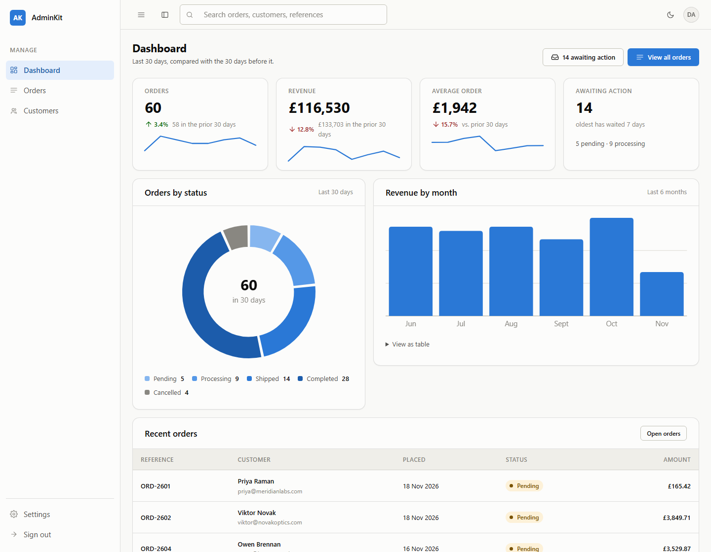
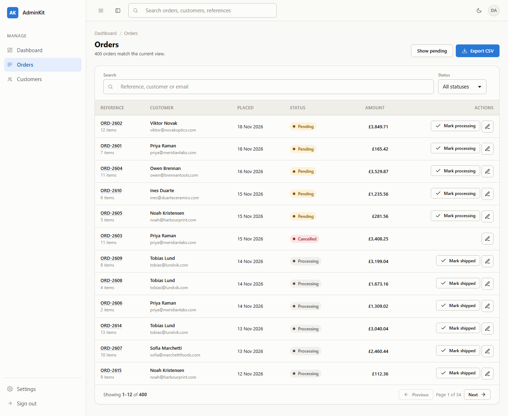
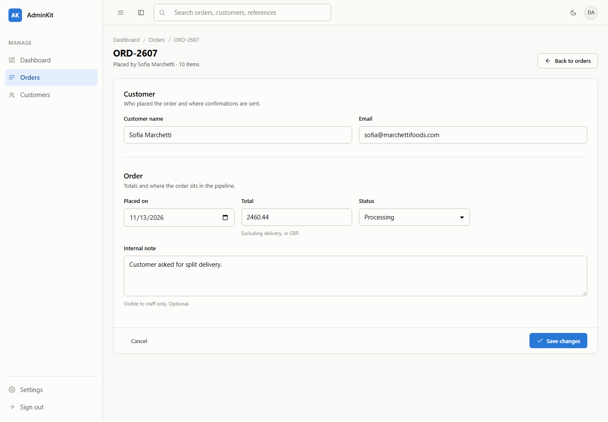
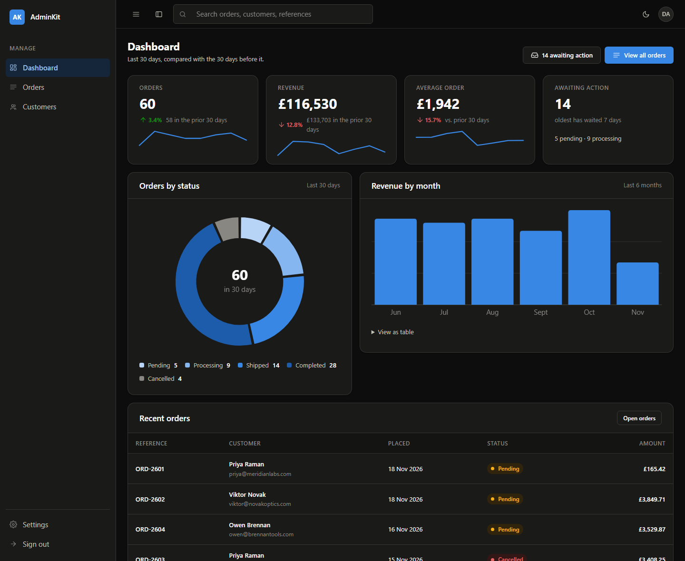

# AdminKit

A small ASP.NET Core admin panel built to show how an older server-rendered
back office can be modernised without rewriting it as a SPA.

Everything renders server-side with Razor Pages. The CSS is hand-written against
a token file — no Bootstrap, no Tailwind, no component library. The charts are
inline SVG generated in C# — no charting library. There is no npm install and no
build step: clone it and press run.



| Orders list | Order form | Dark mode |
|---|---|---|
|  |  |  |

## Run it

```bash
dotnet run --project src/AdminKit.Web
```

Then open the URL printed in the console. Requires the .NET 10 SDK.

## What is in it

| Page | What it demonstrates |
|---|---|
| `/` | KPI tiles with sparklines, a doughnut and a bar chart, both inline SVG |
| `/Orders` | Search, status filter, sortable columns, pagination, inline row actions, CSV export |
| `/Orders/Edit/{id}` | Reactive-style form with server validation, field-level errors, post-redirect-get |
| `/Customers` | A second list view sharing the same table and filter components |
| `/Settings` | Sectioned form with a sticky action bar and real switch controls |
| `/Login` | Chrome-free layout variant |

## How it is put together

```
src/AdminKit.Web/
├── Models/            Order, Customer, query and paging records
├── Services/
│   ├── InMemoryOrderStore.cs   Seeded data, filtering, sorting, paging
│   └── ChartMath.cs            SVG path geometry for the charts
├── Pages/
│   ├── Shared/        Layout, sidebar, topbar, toast, icon set, status badge
│   ├── Orders/        List and edit
│   └── Customers/     List
└── wwwroot/
    ├── css/           tokens → base → layout → components
    └── js/            app.js (theme, nav, filters, toasts), charts.js (tooltips)
```

Four CSS files, loaded in that order. `tokens.css` holds every colour, space and
radius; nothing below it contains a raw hex value. Dark mode is a second set of
token values, declared once for the OS setting and once for the in-app toggle.

## Deliberate constraints

- **No JavaScript dependency for anything that matters.** Filtering, sorting and
  paging are GET parameters handled on the server. `app.js` only adds debounced
  search, the sidebar collapse and toast dismissal. Turn JavaScript off and the
  orders table still filters, sorts and pages.
- **No database.** `InMemoryOrderStore` seeds 400 orders across 200 days from a
  fixed `Random` seed, so the numbers are identical on every run and every
  machine. Order volume is flat and status follows from age, which keeps the
  period-on-period figures on the dashboard believable.
- **No authentication.** `/Login` is a visual exercise; it posts straight to the
  dashboard.
- **Fixed `en-GB` culture**, set in `Program.cs`, so dates and currency render
  the same regardless of the host machine's locale.

## Not included

No database, no EF Core, no real authentication, no automated tests, no CI/CD,
no deployment configuration. This is a front-end demo with just enough C# behind
it to be real rather than a static mockup.

## About this repository

This is a personal demo written to show UI and UX work on the ASP.NET stack. It
is not a client project and contains no client code or data. The companies and
people in the seed data are invented.

See [DESIGN-NOTES.md](DESIGN-NOTES.md) for the reasoning behind the interface
decisions.
